# 《在平均答案之外》抽象艺术配图备选

核验日期：2026-11-10。本轮新增 **15 张**，累计 **22 张高清 JPEG、12 位艺术家**；另有 **3 件只留链接待授权/咨询**。从 PR #51 合并后的 main 扩展，全部仍供作者在 Git 分支审阅，没有加入正文、`public/` 或网站组件。

## 怎么看

- 下方直接预览入库图，点击「本地原文件」查看完整图；每件都有拟用章节、准确媒介、来源、权利依据和建议署名。
- [manifest.json](manifest.json) 记录逐件下载 URL、馆藏编号、实测像素、字节数与 SHA-256；[source-checks.json](source-checks.json) 保留本轮新增图像的馆方权利/图像事实字段，供复查。
- `originals/` 是下载后原样保留的 JPEG：没有裁切、缩放、调色、重新压缩或 AI 重绘，**不等于每件都是馆方最大档案母版**。共约 **72.3 MB**。
- 这次增加粉彩、拼贴、木刻、油毡版画、几何构成与黑白线条，避免只加同一位画家的近似作品。A13、A17 是含文字的封面设计；A12、A14、A21、A22 保留可辨识具象元素，应作为扩展备选，不混称纯抽象油画。
- 原图可能含纸张边缘、画框或跨页。像素描述**整个文件**，不等于画心像素；排版前再决定是否裁切，当前没有改图。
- 中文题名为工作译名。章节对应是编选联想，不是艺术史定论或画家意图。

## 可先比较的一组

| 章节 | 彩色 / 主选方向 | 另一种节奏 |
| --- | --- | --- |
| 第一章｜当答案变得不稀奇 | A01 Kandinsky；A11 Wadsworth 的交错平面；A15 Jacoba 的彩色木刻 | 本轮 Kandinsky《即兴第30号》的强烈线条 |
| 第二章｜什么不会被模型吞掉 | A04 Klee 的人物与线条 | A13 Schlemmer 的几何侧脸；A14 Klee 的蚀刻侧脸 |
| 第三章｜第一笔钱从哪里来 | A02 Klee 的树与建筑；A09 Schwitters 的拼贴材料 | A17 Lissitzky 的封面展开图，须保留其设计身份 |
| 第四章｜生意开始以后的一天 | A03 Mondrian；A18 Van Doesburg 的边界与斜置画面 | A10 Schwitters 的黑白网格；A16 Jacoba 的黑白流线；A22 Klee 的细线平衡 |
| 第五章｜还要不要继续 | A07 Delaunay；A08 Freundlich 的转向色带 | A12 Marc 的有机木刻，或 A06 较轻的复制品方向 |

## 像素与印刷使用

- 本轮不靠放大达到“高清”。入库门槛为**长边至少 3000、短边至少 2000 px**。此前 2500 px 短边门槛会误排除馆方原生的长方形印张和双页封面，因此改为同时检查长短边，并逐图记录真实像素。
- 2000 px 在 300 ppi 下约 16.9 cm；新增图在清单中提供完整图像的 300 ppi 尺寸。是否适合整页仍取决于版心、出血、裁切与纸张，不把这些文件自动视为可做任意尺寸印刷。
- Cleveland 的高清 print JPEG 保留原样，较大的 TIFF 只给馆方直链，未把数十至上百 MB 的单张 TIFF 加进普通 Git。NGA 端点本次实际返回 4096 px 长边，以解码结果为准，不使用目录中更大的数值冒充实得尺寸。

## 已入库的高清文件

### A01 · Vasily Kandinsky · 有绿色中心的画

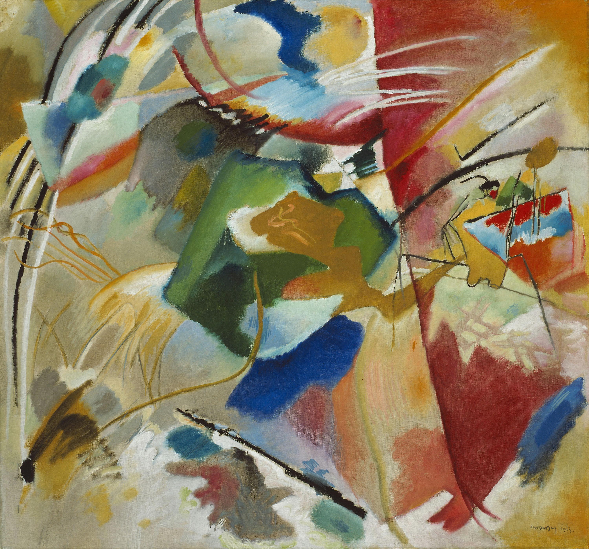

**Painting with Green Center**，1913。Oil on canvas。

- 馆藏：The Art Institute of Chicago，1931.510。
- 文件：3000 × 2793 px，2.88 MB；[本地原文件](originals/kandinsky-painting-with-green-center-1913.jpg) · [馆方作品页](https://www.artic.edu/artworks/8987/painting-with-green-center)。
- 拟用：**第一章｜当答案变得不稀奇**。颜色与线条交错，视觉上适合第一章里同时出现的答案与判断；这是编选联想，不是画家创作意图的断言。
- 授权：馆方 API is_public_domain=true；Commons 对这一数码复制件明确标示 CC0，并列出 Art Institute 原始导出来源。
- 注意：馆方网页/IIIF 本次返回 403，采用 Commons 保存的馆方高清导出文件；不是本次直接取得的最新馆方母版。Commons 上传记录指向旧 image_id 818b8583-5214-6ce0-0ba3-1eee3656be13；当前 API image_id 为 c68f33ec-feb1-5277-334b-b71ac15ae394。
- 核验来源：[来源 1](https://api.artic.edu/api/v1/artworks/8987) · [来源 2](https://commons.wikimedia.org/wiki/File:Vasily_Kandinsky_-_Painting_with_Green_Center_-_1931.510_-_Art_Institute_of_Chicago.jpg) · [来源 3](https://www.artic.edu/open-access/open-access-images)。

建议署名：Vasily Kandinsky, Painting with Green Center, 1913. The Art Institute of Chicago, Arthur Jerome Eddy Memorial Collection, 1931.510. CC0; museum image via Wikimedia Commons.

### A02 · Paul Klee · 树与建筑：节奏

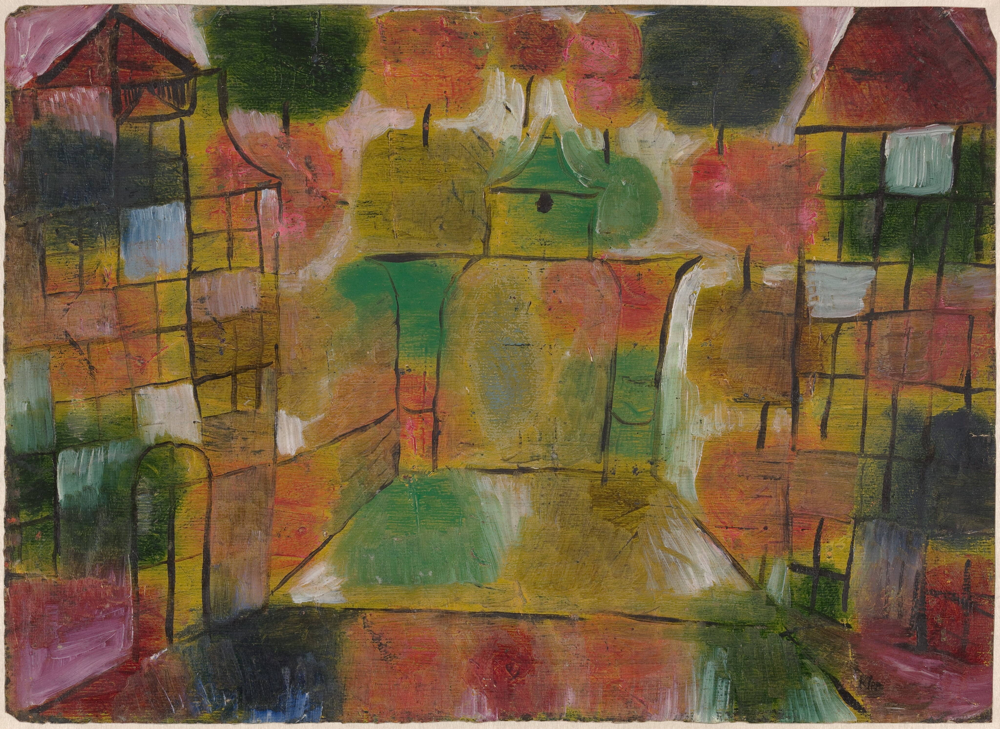

**Baum und Architektur—Rhythmen (Tree and Architecture—Rhythms)**，1920。Oil on paper。

- 馆藏：National Gallery of Art, Washington，2004.140.41.a。
- 文件：4096 × 2989 px，3.66 MB；[本地原文件](originals/klee-tree-and-architecture-rhythms-1920.jpg) · [馆方作品页](https://www.nga.gov/artworks/130844-baum-und-architektur-rhythmen-tree-and-architecture-rhythms)。
- 拟用：**第三章｜第一笔钱从哪里来**。建筑线条与树形彼此穿插，可陪伴第三章关于把想法放回具体交易与环境的讨论。
- 授权：作品页明确标示媒体免费且属公版，并提供下载；NGA Open Access 政策将这类图像以 CC0 发布。
- 注意：务必使用 .a / 130844；相近标题的 .b / 130845 是另一件水彩，页面不提供下载。
- 核验来源：[来源 1](https://www.nga.gov/artworks/130844-baum-und-architektur-rhythmen-tree-and-architecture-rhythms) · [来源 2](https://www.nga.gov/terms-and-notices)。

建议署名：Paul Klee, Tree and Architecture—Rhythms, 1920. Gift of Benjamin and Lillian Hertzberg, 2004.140.41.a. Courtesy National Gallery of Art, Washington. CC0.

### A03 · Piet Mondrian · 红、黄、蓝的构成

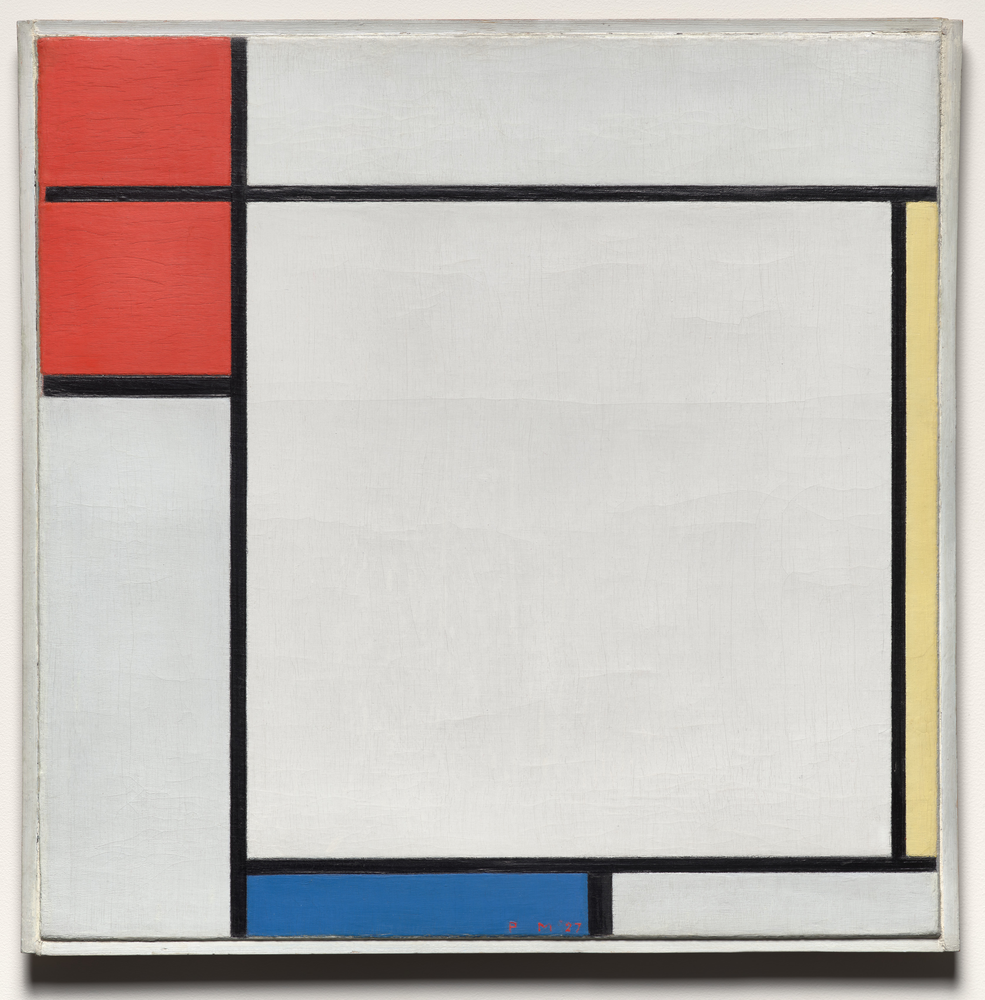

**Composition with Red, Yellow, and Blue**，1927。Oil on canvas。

- 馆藏：The Cleveland Museum of Art，1967.215。
- 文件：3352 × 3400 px，2.82 MB；[本地原文件](originals/mondrian-composition-with-red-yellow-blue-1927.jpg) · [馆方作品页](https://www.clevelandart.org/art/1967.215)。
- 拟用：**第四章｜生意开始以后的一天**。清楚的分割、留白与边界，适合第四章关于一天的工作安排和停止工作的权利。
- 授权：馆方作品页允许复制、修改和分发；API share_license_status=CC0，所用 URL 来自 images.print。
- 注意：原样保存馆方 print JPEG。馆方另有 9856×9998 TIFF（约 296 MB），未提交大型 TIFF；不是馆方最大档案母版。
- 核验来源：[来源 1](https://www.clevelandart.org/art/1967.215) · [来源 2](https://openaccess-api.clevelandart.org/api/artworks/1967.215) · [来源 3](https://www.clevelandart.org/open-access)。

建议署名：Piet Mondrian, Composition with Red, Yellow, and Blue, 1927. The Cleveland Museum of Art, Contemporary Collection of The Cleveland Museum of Art, 1967.215. CC0.

[馆方更大 TIFF](https://openaccess-cdn.clevelandart.org/1967.215/1967.215_full.tif)：9856 × 9998 px，馆方 API 报告 295,646,980 bytes。本分支只保存未改动的 print JPEG，避免向普通 Git 提交约 296 MB 单文件。

### A04 · Paul Klee · 带人物的构成

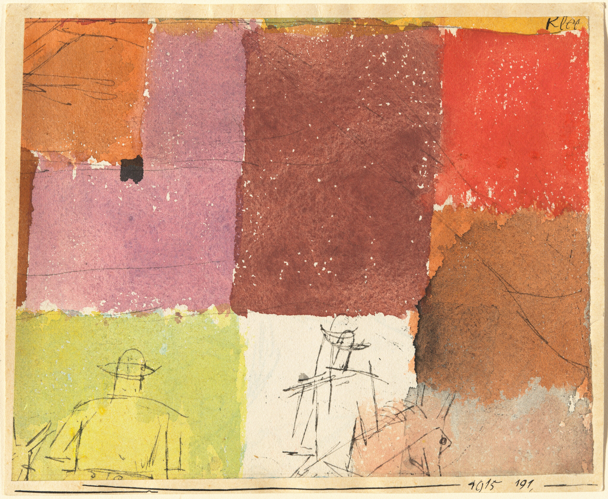

**Composition with Figures**，1915。Pen and ink and watercolor on paper mounted on card stock。

- 馆藏：National Gallery of Art, Washington，2014.18.25。
- 文件：4096 × 3359 px，4.48 MB；[本地原文件](originals/klee-composition-with-figures-1915.jpg) · [馆方作品页](https://www.nga.gov/artworks/164935-composition-figures)。
- 拟用：**第二章｜什么不会被模型吞掉**。人物与抽象线条并置，可作为第二章里个人经验、关系和共同学习的备选。
- 授权：作品页明确标示媒体免费且属公版，并提供下载；对应 NGA CC0 政策。
- 核验来源：[来源 1](https://www.nga.gov/artworks/164935-composition-figures) · [来源 2](https://www.nga.gov/terms-and-notices)。

建议署名：Paul Klee, Composition with Figures, 1915. Collection of Mr. and Mrs. Paul Mellon, 2014.18.25. Courtesy National Gallery of Art, Washington. CC0.

### A05 · Paul Klee · 小世界

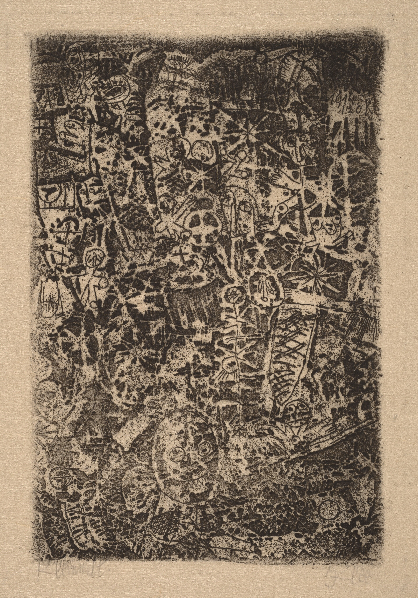

**Small World (Kleinwelt)**，1914。Etching on zinc。

- 馆藏：National Gallery of Art, Washington，1943.3.5188。
- 文件：2868 × 4096 px，4.27 MB；[本地原文件](originals/klee-small-world-1914.jpg) · [馆方作品页](https://www.nga.gov/artworks/8110-small-world-kleinwelt)。
- 拟用：**第三章｜第一笔钱从哪里来**。作为第三章的小幅黑白/线条方向，避免每章都使用高饱和色面。
- 授权：作品页明确标示媒体免费且属公版，并提供下载；对应 NGA CC0 政策。
- 注意：这是一件蚀刻版画，不是油画；适合作为抽象线条方向的扩展备选。
- 核验来源：[来源 1](https://www.nga.gov/artworks/8110-small-world-kleinwelt) · [来源 2](https://www.nga.gov/terms-and-notices)。

建议署名：Paul Klee, Small World (Kleinwelt), 1914. Rosenwald Collection, 1943.3.5188. Courtesy National Gallery of Art, Washington. CC0.

### A06 · Paul Klee · 公园

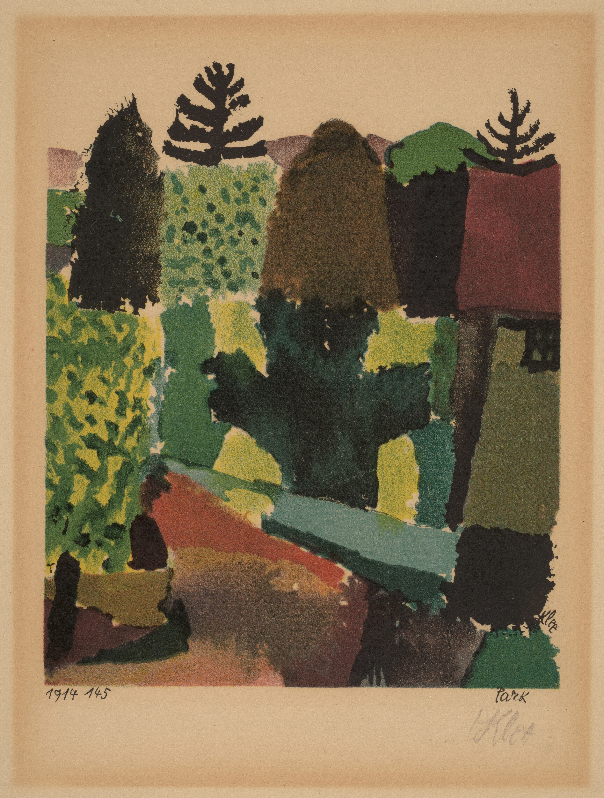

**Park**，1920。Color lithographic facsimile on laid paper。

- 馆藏：National Gallery of Art, Washington，1998.121.1。
- 文件：3103 × 4096 px，3.58 MB；[本地原文件](originals/klee-park-1920-facsimile.jpg) · [馆方作品页](https://www.nga.gov/artworks/108314-park)。
- 拟用：**第五章｜还要不要继续**。可作为第五章的较轻、较开放的尾声，给是否继续保留空间。
- 授权：作品页明确标示媒体免费且属公版，并提供下载；对应 NGA CC0 政策。
- 注意：馆藏物是彩色石版复制品，不是原作绘画。馆方条目年代为 1920；图中原作题记含 1914。保留差异，不把复制品称为原画。
- 核验来源：[来源 1](https://www.nga.gov/artworks/108314-park) · [来源 2](https://www.nga.gov/terms-and-notices)。

建议署名：Paul Klee, Park, 1920, color lithographic facsimile. Gift of Mrs. John Alexander Pope, 1998.121.1. Courtesy National Gallery of Art, Washington. CC0.

### A07 · Robert Delaunay · 节奏第2号：为杜伊勒里沙龙所作的装饰画

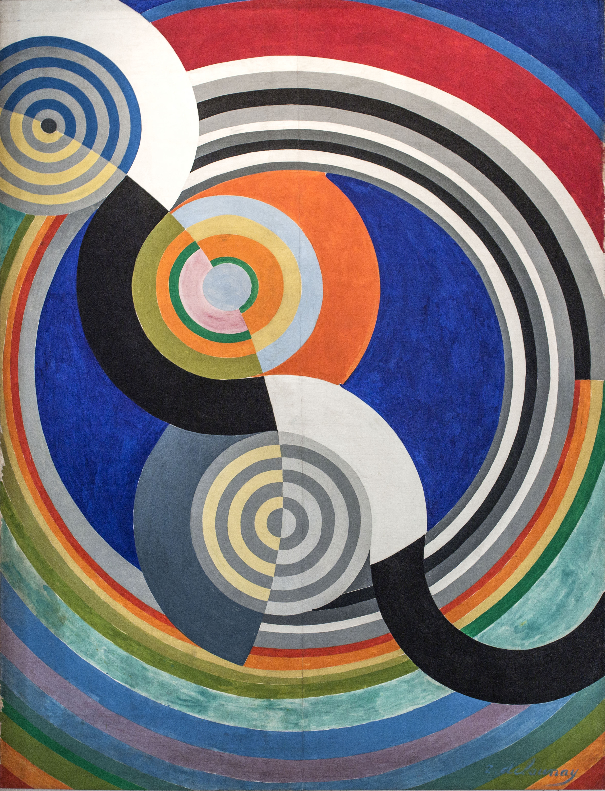

**Rythme n°2, décoration pour le Salon des Tuileries**，1938。Oil on canvas。

- 馆藏：Musée d’Art moderne de Paris，AMVP 2575。
- 文件：3661 × 4785 px，2.95 MB；[本地原文件](originals/delaunay-rythme-no-2-tuileries-1938.jpg) · [馆方作品页](https://www.parismuseescollections.paris.fr/en/node/380950)。
- 拟用：**第五章｜还要不要继续**。圆弧、重复与方向变化可作为第五章“还要不要继续”的强节奏版本，也可与 Mondrian 的静态分割比较。
- 授权：馆方作品页、IIIF 图像 metadata 和 Commons 文件页均明确标示 CC0 Paris Musées。Commons 图像编号 81323-3 与馆方 manifest 的 LPDP_81323-3 一致。
- 注意：这是大型油画 AMVP 2575，不是同名水粉草图 AMD 1324。保存 Commons 镜像的馆方高清文件，非新获取的档案母版。嵌入旧元数据保留广告/衍生品提示；本次依馆方现行逐图 CC0 和开放政策记录，不宣称任何馆方背书。
- 核验来源：[来源 1](https://www.parismuseescollections.paris.fr/en/node/380950) · [来源 2](https://apicollections.parismusees.paris.fr/iiif/419/manifest) · [来源 3](https://commons.wikimedia.org/wiki/File:Robert_Delaunay_-_Rythme_n%C2%B02,_d%C3%A9coration_pour_le_salon_des_Tuileries_-_1938_-_Mus%C3%A9e_d%27art_moderne_de_la_Ville_de_Paris.jpg) · [来源 4](https://parismusees.paris.fr/en/news/open-content-150000-works-from-the-museum-collections-of-the-city-of-paris-freely-available)。

建议署名：Robert Delaunay, Rythme n°2, décoration pour le Salon des Tuileries, 1938. Musée d’Art moderne de Paris, AMVP 2575. CC0 Paris Musées / Musée d’art moderne de Paris; museum image via Wikimedia Commons.

## 本轮新增的高清文件

### A08 · Otto Freundlich · 构成

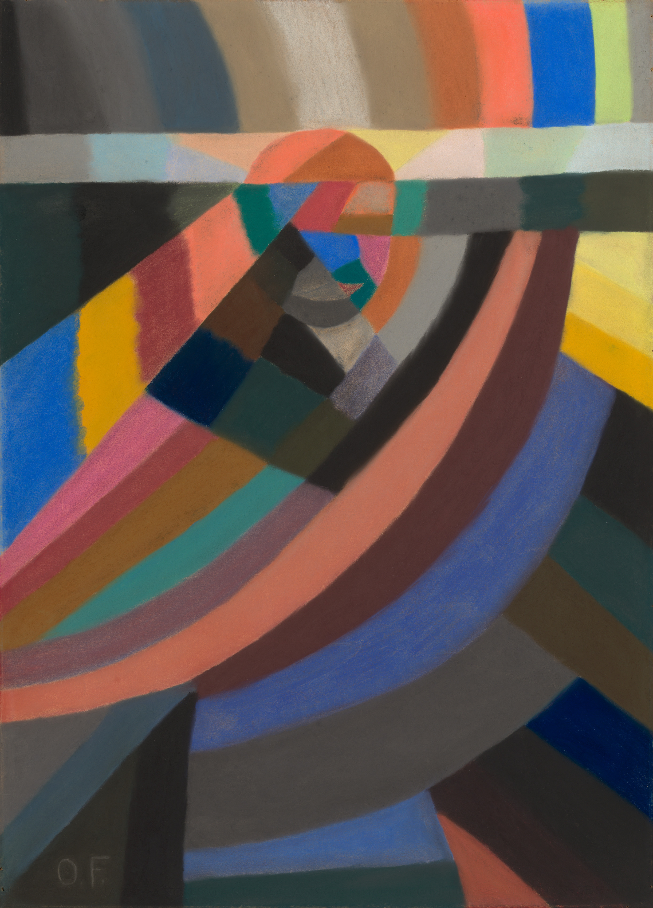

**Composition**，1924。pastel。

- 馆藏：The Cleveland Museum of Art，1992.277。
- 文件：2446 × 3400 px，1.80 MB；[本地原文件](originals/freundlich-composition-1924.jpg) · [馆方作品页](https://www.clevelandart.org/art/1992.277)。
- 拟用：**第五章｜还要不要继续**。彩色粉笔的弧线与色带在同一画面里转向，适合第五章关于继续、调整与重新选择的讨论。
- 权利依据：逐件馆方 API share_license_status=CC0；文件 URL 来自该条目 images.print。作品页允许复制、修改和分发；CMA 条款明确 CC0 内容可免费作商业与非商业使用及再分发。
- 注意：粉彩，非油画；保留纸张边缘。 原样保存馆方 print JPEG，不是最大档案母版；更大 TIFF 仅留直链。
- 核验来源：[来源 1](https://www.clevelandart.org/art/1992.277) · [来源 2](https://openaccess-api.clevelandart.org/api/artworks/1992.277) · [来源 3](https://www.clevelandart.org/terms-and-conditions) · [来源 4](https://www.clevelandart.org/open-access)。

建议署名：Otto Freundlich, Composition, 1924. The Cleveland Museum of Art, Bequest of Lockwood Thompson, 1992.277. CC0.

[馆方更大 TIFF](https://openaccess-cdn.clevelandart.org/1992.277/1992.277_full.tif)：5279 × 7339 px，馆方报告 116,256,976 bytes。未入库。

### A09 · Kurt Schwitters · 小舞蹈

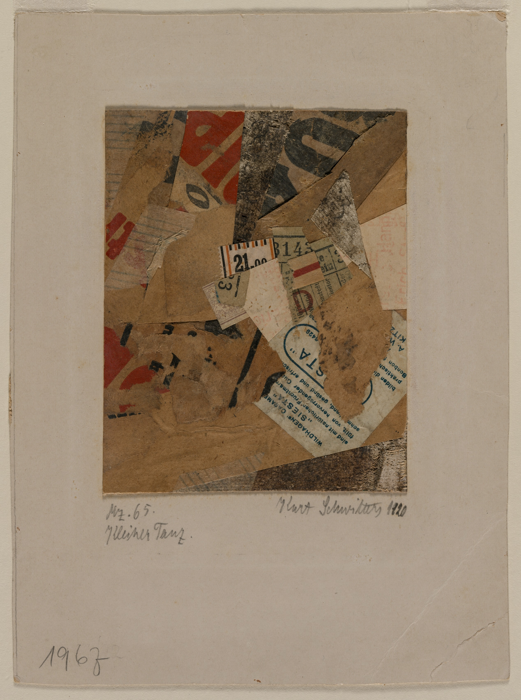

**Little Dance**，1920。collage。

- 馆藏：The Cleveland Museum of Art，1963.1。
- 文件：2535 × 3400 px，2.14 MB；[本地原文件](originals/schwitters-little-dance-1920.jpg) · [馆方作品页](https://www.clevelandart.org/art/1963.1)。
- 拟用：**第三章｜第一笔钱从哪里来**。票据、印刷碎片和不同质地被重新组织，适合第三章从手边材料开始试一次真实交易的语境。
- 权利依据：逐件馆方 API share_license_status=CC0；文件 URL 来自该条目 images.print。作品页允许复制、修改和分发；CMA 条款明确 CC0 内容可免费作商业与非商业使用及再分发。
- 注意：拼贴，非油画；文件包含较宽的纸张留白，画心小于全图像素。 原样保存馆方 print JPEG，不是最大档案母版；更大 TIFF 仅留直链。
- 核验来源：[来源 1](https://www.clevelandart.org/art/1963.1) · [来源 2](https://openaccess-api.clevelandart.org/api/artworks/1963.1) · [来源 3](https://www.clevelandart.org/terms-and-conditions) · [来源 4](https://www.clevelandart.org/open-access)。

建议署名：Kurt Schwitters, Little Dance, 1920. The Cleveland Museum of Art, Contemporary Collection of The Cleveland Museum of Art, 1963.1. CC0.

[馆方更大 TIFF](https://openaccess-cdn.clevelandart.org/1963.1/1963.1_full.tif)：5009 × 6717 px，馆方报告 100,964,372 bytes。未入库。

### A10 · Kurt Schwitters · Merz 3版画集：第1版

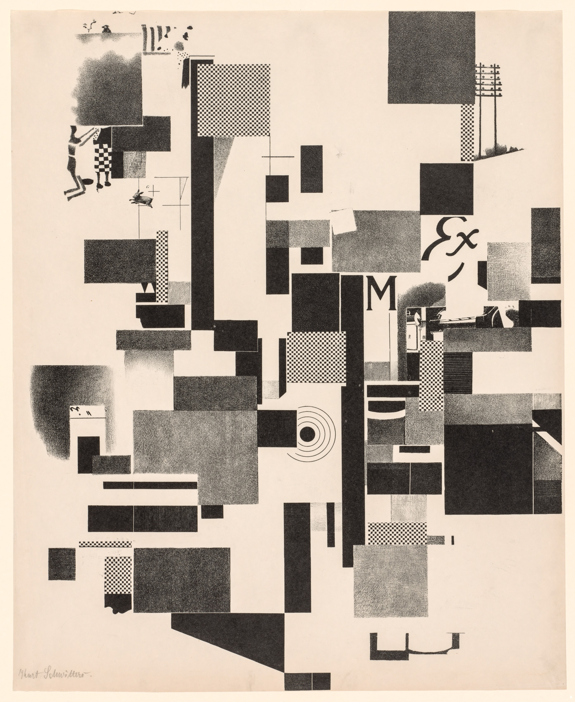

**Merz 3 Portfolio:  Plate 1**，1923。lithograph。

- 馆藏：The Cleveland Museum of Art，1995.4。
- 文件：2785 × 3400 px，2.42 MB；[本地原文件](originals/schwitters-merz-3-plate-1-1923.jpg) · [馆方作品页](https://www.clevelandart.org/art/1995.4)。
- 拟用：**第四章｜生意开始以后的一天**。黑白矩形、网格与零散符号形成不完全规则的秩序，可与第四章的日常工作安排并置。
- 权利依据：逐件馆方 API share_license_status=CC0；文件 URL 来自该条目 images.print。作品页允许复制、修改和分发；CMA 条款明确 CC0 内容可免费作商业与非商业使用及再分发。
- 注意：石版画，非原始拼贴；保留印张边缘。 原样保存馆方 print JPEG，不是最大档案母版；更大 TIFF 仅留直链。
- 核验来源：[来源 1](https://www.clevelandart.org/art/1995.4) · [来源 2](https://openaccess-api.clevelandart.org/api/artworks/1995.4) · [来源 3](https://www.clevelandart.org/terms-and-conditions) · [来源 4](https://www.clevelandart.org/open-access)。

建议署名：Kurt Schwitters, Merz 3 Portfolio:  Plate 1, 1923. The Cleveland Museum of Art, Dudley P. Allen Fund, 1995.4. CC0.

[馆方更大 TIFF](https://openaccess-cdn.clevelandart.org/1995.4/1995.4_full.tif)：4616 × 5636 px，馆方报告 78,080,644 bytes。未入库。

### A11 · Edward Alexander Wadsworth · 打开的窗

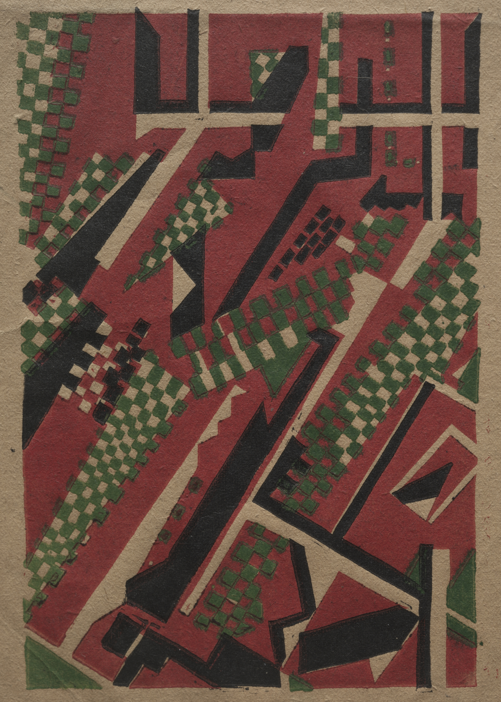

**The Open Window**，c. 1914。color woodcut。

- 馆藏：The Cleveland Museum of Art，1987.49。
- 文件：2429 × 3400 px，5.82 MB；[本地原文件](originals/wadsworth-open-window-1914.jpg) · [馆方作品页](https://www.clevelandart.org/art/1987.49)。
- 拟用：**第一章｜当答案变得不稀奇**。倾斜平面和棋盘纹提供多个观看方向，适合第一章中答案增多之后仍需选择视角的主题。
- 权利依据：逐件馆方 API share_license_status=CC0；文件 URL 来自该条目 images.print。作品页允许复制、修改和分发；CMA 条款明确 CC0 内容可免费作商业与非商业使用及再分发。
- 注意：彩色木刻版画；这一件为特定配色版本，不代表全部六个版本。 原样保存馆方 print JPEG，不是最大档案母版；更大 TIFF 仅留直链。
- 核验来源：[来源 1](https://www.clevelandart.org/art/1987.49) · [来源 2](https://openaccess-api.clevelandart.org/api/artworks/1987.49) · [来源 3](https://www.clevelandart.org/terms-and-conditions) · [来源 4](https://www.clevelandart.org/open-access)。

建议署名：Edward Alexander Wadsworth, The Open Window, c. 1914. The Cleveland Museum of Art, John L. Severance Fund, 1987.49. CC0.

[馆方更大 TIFF](https://openaccess-cdn.clevelandart.org/1987.49/1987.49_full.tif)：3931 × 5503 px，馆方报告 64,930,064 bytes。未入库。

### A12 · Franz Marc · 创世记II

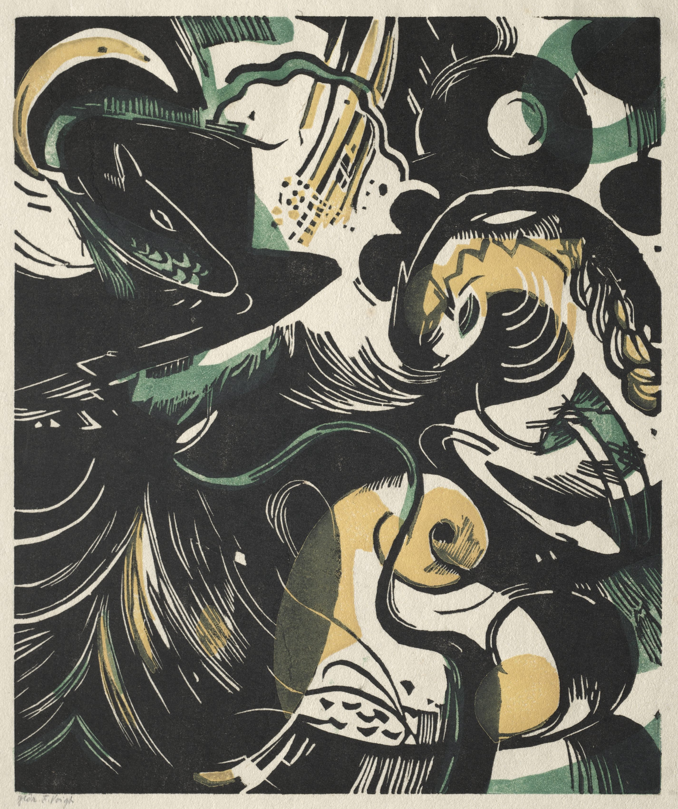

**Genesis II**，1914。color woodcut。

- 馆藏：The Cleveland Museum of Art，1959.228。
- 文件：2852 × 3400 px，6.85 MB；[本地原文件](originals/marc-genesis-ii-1914.jpg) · [馆方作品页](https://www.clevelandart.org/art/1959.228)。
- 拟用：**第五章｜还要不要继续**。黑、绿与淡黄的有机线条带有生成和运动感，可作为第五章更有张力的备选。
- 权利依据：逐件馆方 API share_license_status=CC0；文件 URL 来自该条目 images.print。作品页允许复制、修改和分发；CMA 条款明确 CC0 内容可免费作商业与非商业使用及再分发。
- 注意：表现主义彩色木刻，含抽象化的马与创世题材，并非纯非具象绘画。 原样保存馆方 print JPEG，不是最大档案母版；更大 TIFF 仅留直链。
- 核验来源：[来源 1](https://www.clevelandart.org/art/1959.228) · [来源 2](https://openaccess-api.clevelandart.org/api/artworks/1959.228) · [来源 3](https://www.clevelandart.org/terms-and-conditions) · [来源 4](https://www.clevelandart.org/open-access)。

建议署名：Franz Marc, Genesis II, 1914. The Cleveland Museum of Art, Gift of The Print Club of Cleveland, 1959.228. CC0.

[馆方更大 TIFF](https://openaccess-cdn.clevelandart.org/1959.228/1959.228_full.tif)：3050 × 3636 px，馆方报告 33,306,944 bytes。未入库。

### A13 · Oskar Schlemmer · 头部游戏

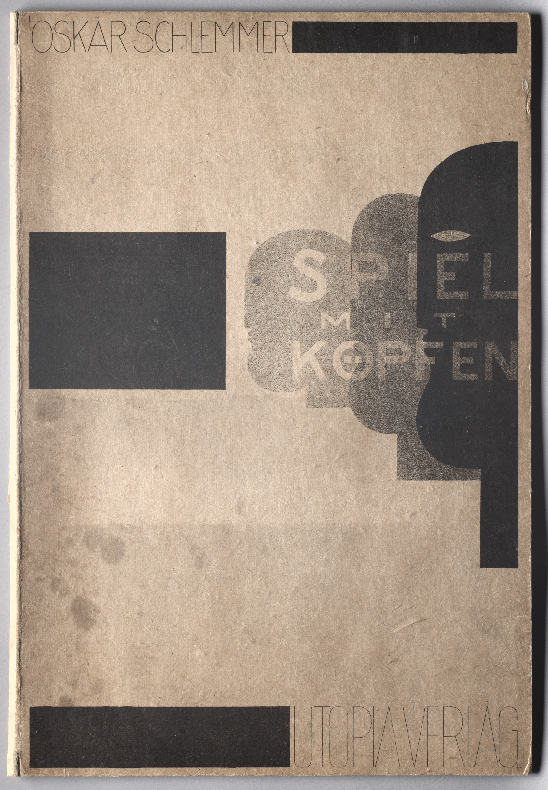

**Play with Heads**，1923。lithograph。

- 馆藏：The Cleveland Museum of Art，2000.120。
- 文件：2360 × 3400 px，2.29 MB；[本地原文件](originals/schlemmer-play-with-heads-1923.jpg) · [馆方作品页](https://www.clevelandart.org/art/2000.120)。
- 拟用：**第二章｜什么不会被模型吞掉**。重叠侧脸与几何块面适合第二章里人与关系的讨论，作为更克制的黑白方向。
- 权利依据：逐件馆方 API share_license_status=CC0；文件 URL 来自该条目 images.print。作品页允许复制、修改和分发；CMA 条款明确 CC0 内容可免费作商业与非商业使用及再分发。
- 注意：石版画作品集的封面图像，含文字；不是画集中所有单张，不是油画。 原样保存馆方 print JPEG，不是最大档案母版；更大 TIFF 仅留直链。
- 核验来源：[来源 1](https://www.clevelandart.org/art/2000.120) · [来源 2](https://openaccess-api.clevelandart.org/api/artworks/2000.120) · [来源 3](https://www.clevelandart.org/terms-and-conditions) · [来源 4](https://www.clevelandart.org/open-access)。

建议署名：Oskar Schlemmer, Play with Heads, 1923. The Cleveland Museum of Art, John L. Severance Fund, 2000.120. CC0.

[馆方更大 TIFF](https://openaccess-cdn.clevelandart.org/2000.120/2000.120_full.tif)：3870 × 5576 px，馆方报告 64,761,664 bytes。未入库。

### A14 · Paul Klee · 计算中的老人

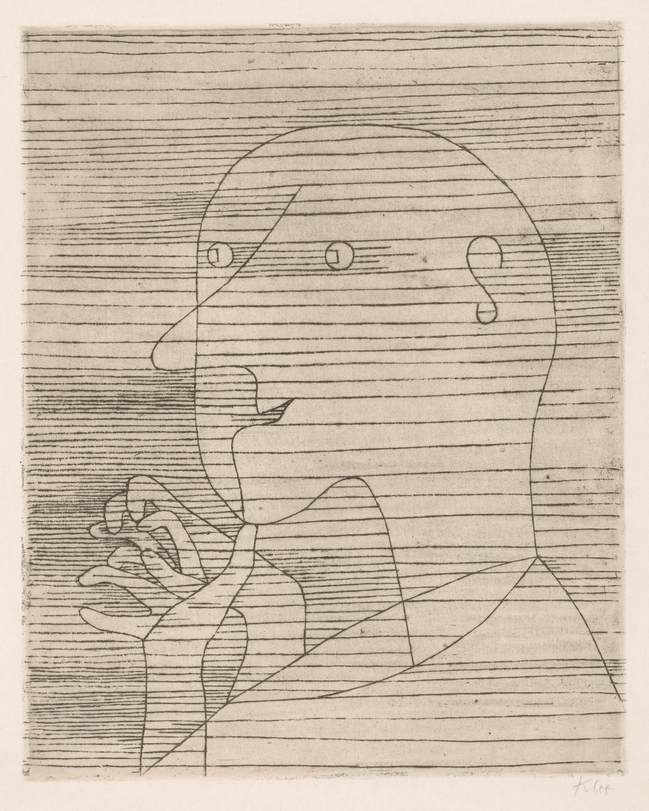

**The Calculating Old Man**，1929。etching。

- 馆藏：The Cleveland Museum of Art，1978.18。
- 文件：2720 × 3400 px，2.28 MB；[本地原文件](originals/klee-calculating-old-man-1929.jpg) · [馆方作品页](https://www.clevelandart.org/art/1978.18)。
- 拟用：**第二章｜什么不会被模型吞掉**。密集横线与几何化侧脸把人物和规则放在同一画面中，可作为第二章关于人的判断的克制黑白备选。
- 权利依据：逐件馆方 API share_license_status=CC0；文件 URL 来自该条目 images.print。作品页允许复制、修改和分发；CMA 条款明确 CC0 内容可免费作商业与非商业使用及再分发。
- 注意：蚀刻版画，有明确人物侧脸，是抽象化人物方向，不是纯非具象油画。原样保留纸张边缘；未裁切。馆方更大 TIFF 只保留直链。
- 核验来源：[来源 1](https://www.clevelandart.org/art/1978.18) · [来源 2](https://openaccess-api.clevelandart.org/api/artworks/1978.18) · [来源 3](https://www.clevelandart.org/terms-and-conditions) · [来源 4](https://www.clevelandart.org/open-access)。

建议署名：Paul Klee, The Calculating Old Man, 1929. The Cleveland Museum of Art, Dudley P. Allen Fund, 1978.18. CC0.

[馆方更大 TIFF](https://openaccess-cdn.clevelandart.org/1978.18/1978.18_full.tif)：5222 × 6528 px，馆方报告 102,299,792 bytes。未入库。

### A15 · Jacoba van Heemskerck van Beest · 构成

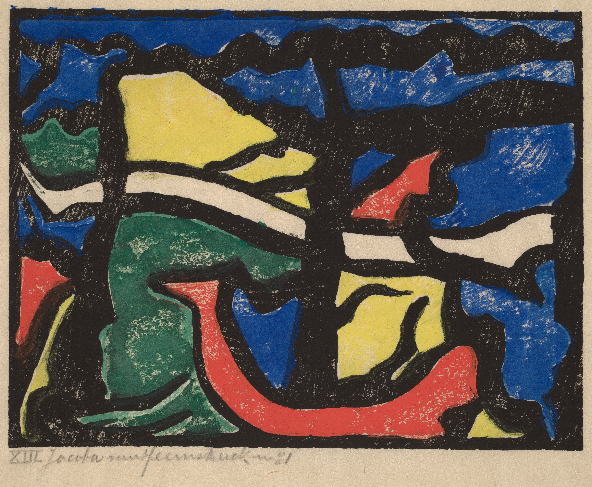

**Composition**，1914/1915。color woodcut on Japan paper。

- 馆藏：National Gallery of Art, Washington，2012.92.273。
- 文件：4096 × 3371 px，3.75 MB；[本地原文件](originals/heemskerck-composition-1914-1915.jpg) · [馆方作品页](https://www.nga.gov/artworks/153658-composition)。
- 拟用：**第一章｜当答案变得不稀奇**。彩色木刻中强烈的线条与交错平面提供与几何格网不同的方向，适合第一章对复杂性与判断的讨论。
- 权利依据：逐件馆方作品页标示图像为公版并提供下载；馆方 published_images 数据 openaccess=1。NGA 条款明确这些图像以 CC0 供商业与非商业使用，无需申请许可。
- 注意：彩色木刻，不是油画。 馆方下载端点实得长边4096像素，小于目录记录，未放大或修改。
- 核验来源：[来源 1](https://www.nga.gov/artworks/153658-composition) · [来源 2](https://www.nga.gov/terms-and-notices) · [来源 3](https://raw.githubusercontent.com/NationalGalleryOfArt/opendata/main/data/published_images.csv)。

建议署名：Jacoba van Heemskerck van Beest, Composition, 1914/1915. Gift of Ruth Cole Kainen; Courtesy National Gallery of Art, Washington, 2012.92.273. CC0.

### A16 · Jacoba van Heemskerck van Beest · 构成

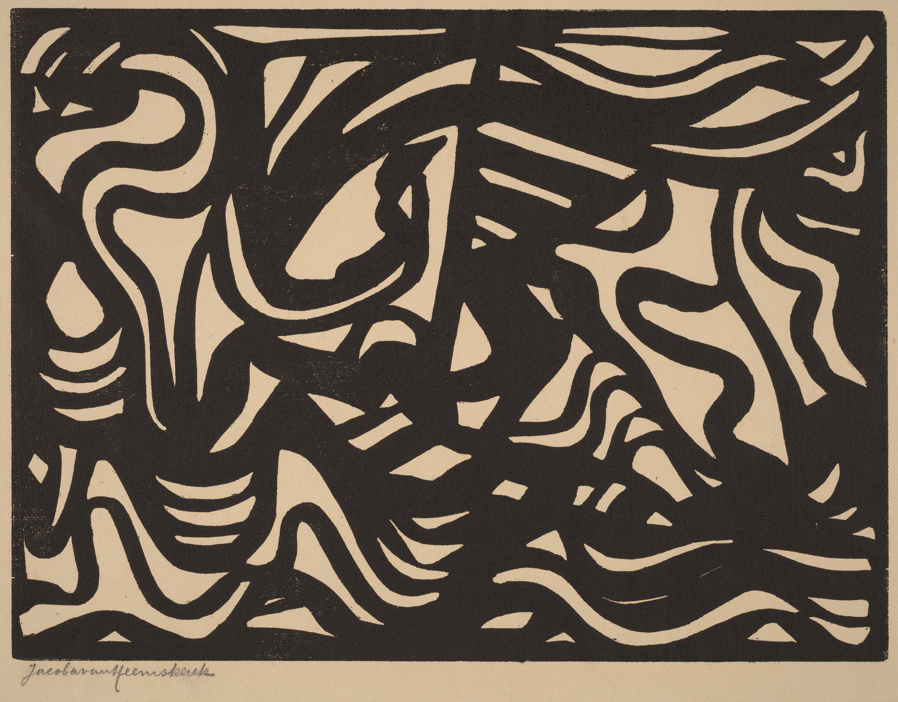

**Composition**，1921。linocut in black on laid paper。

- 馆藏：National Gallery of Art, Washington，2012.92.275。
- 文件：4096 × 3206 px，3.65 MB；[本地原文件](originals/heemskerck-composition-1921.jpg) · [馆方作品页](https://www.nga.gov/artworks/153660-composition)。
- 拟用：**第四章｜生意开始以后的一天**。黑白轮廓既有明确分隔又留有穿行空间，适合第四章对工作边界与弹性的讨论。
- 权利依据：逐件馆方作品页标示图像为公版并提供下载；馆方 published_images 数据 openaccess=1。NGA 条款明确这些图像以 CC0 供商业与非商业使用，无需申请许可。
- 注意：黑色油毡版画，不是油画。 馆方下载端点实得长边4096像素，小于目录记录，未放大或修改。
- 核验来源：[来源 1](https://www.nga.gov/artworks/153660-composition) · [来源 2](https://www.nga.gov/terms-and-notices) · [来源 3](https://raw.githubusercontent.com/NationalGalleryOfArt/opendata/main/data/published_images.csv)。

建议署名：Jacoba van Heemskerck van Beest, Composition, 1921. Gift of Ruth Cole Kainen; Courtesy National Gallery of Art, Washington, 2012.92.275. CC0.

### A17 · El Lissitzky · Wendingen杂志封面

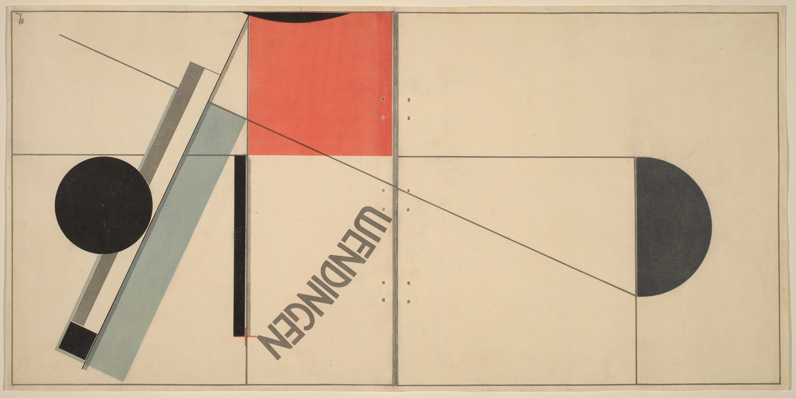

**Wendingen**，1921 (published 1923)。color lithograph; cover for the illustrated magazine "Wendingen" [plus the 36-page text]。

- 馆藏：National Gallery of Art, Washington，1995.77.4。
- 文件：4096 × 2051 px，1.53 MB；[本地原文件](originals/lissitzky-wendingen-1921-published-1923.jpg) · [馆方作品页](https://www.nga.gov/artworks/93943-wendingen)。
- 拟用：**第三章｜第一笔钱从哪里来**。圆、斜线、字形与空白互相接续，可作为第三章把想法组织成可交付之物的设计类备选。
- 权利依据：逐件馆方作品页标示图像为公版并提供下载；馆方 published_images 数据 openaccess=1。NGA 条款明确这些图像以 CC0 供商业与非商业使用，无需申请许可。
- 注意：杂志完整外封展开图，左右两页约2:1；含字体设计，不是单张方形封面或纯抽象绘画。馆藏条目包含36页文字，但本次只下载这一张封面图像。 馆方下载端点实得长边4096像素，小于目录记录，未放大或修改。
- 核验来源：[来源 1](https://www.nga.gov/artworks/93943-wendingen) · [来源 2](https://www.nga.gov/terms-and-notices) · [来源 3](https://raw.githubusercontent.com/NationalGalleryOfArt/opendata/main/data/published_images.csv)。

建议署名：El Lissitzky, Wendingen, 1921 (published 1923). Gift of Frank R. and Jeannette H. Eyerly; Courtesy National Gallery of Art, Washington, 1995.77.4. CC0.

### A18 · Theo van Doesburg · 反构成VII

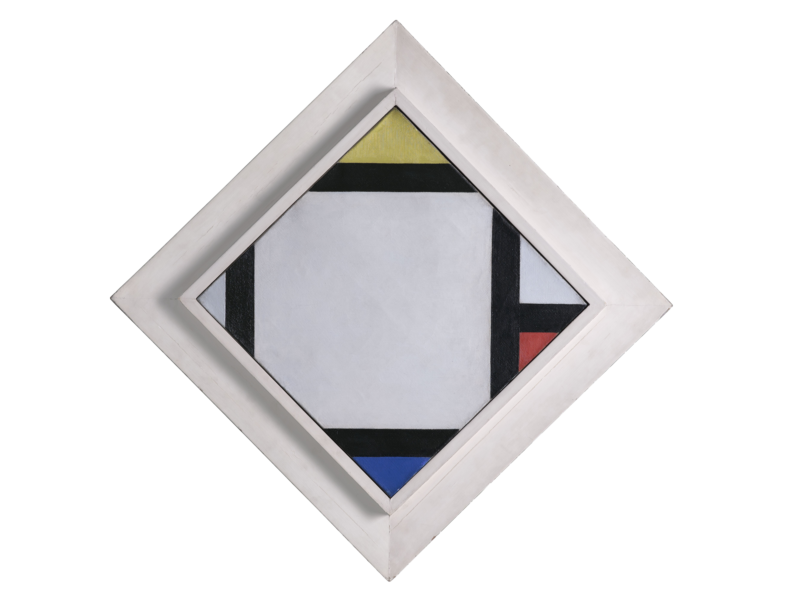

**Contra-compositie VII (Contra-Composition VII)**，1924。Oil on canvas。

- 馆藏：Museum De Lakenhal, Leiden，S 5794。
- 文件：7333 × 5491 px，1.58 MB；[本地原文件](originals/doesburg-contra-composition-vii-1924.jpg) · [馆方作品页](https://www.lakenhal.nl/nl/collectie/s-5794)。
- 拟用：**第四章｜生意开始以后的一天**。斜置外框与内部水平、垂直色块形成张力，可与第四章关于设定边界但不把生活填满的讨论并置。
- 权利依据：Item explicitly states Publiek domein: ja, whose link is CC0 1.0. Museum image policy states downloadable public-domain collection images are copyright-free and may be used for publication. Image URL originates in museum item page sharing metadata; s0 supplies the original resolution, matching museum viewer 7333x5491.
- 注意：馆方原始图像包含完整菱形画作、白色画框与白色背景，未裁切；像素描述整张带框照片，不等于画心像素。馆方建议礼貌署名及出版后寄送样本，不是 CC0 许可条件；本次未寄送或承诺。
- 核验来源：[来源 1](https://www.lakenhal.nl/nl/collectie/s-5794) · [来源 2](https://www.lakenhal.nl/nl/verhaal/beeld-aanvragen) · [来源 3](https://creativecommons.org/publicdomain/zero/1.0/deed.nl)。

建议署名：Theo van Doesburg, Contra-compositie VII, 1924. Collectie Museum De Lakenhal, Leiden, S 5794. CC0.

### A19 · Vasily Kandinsky · 即兴第30号（大炮）

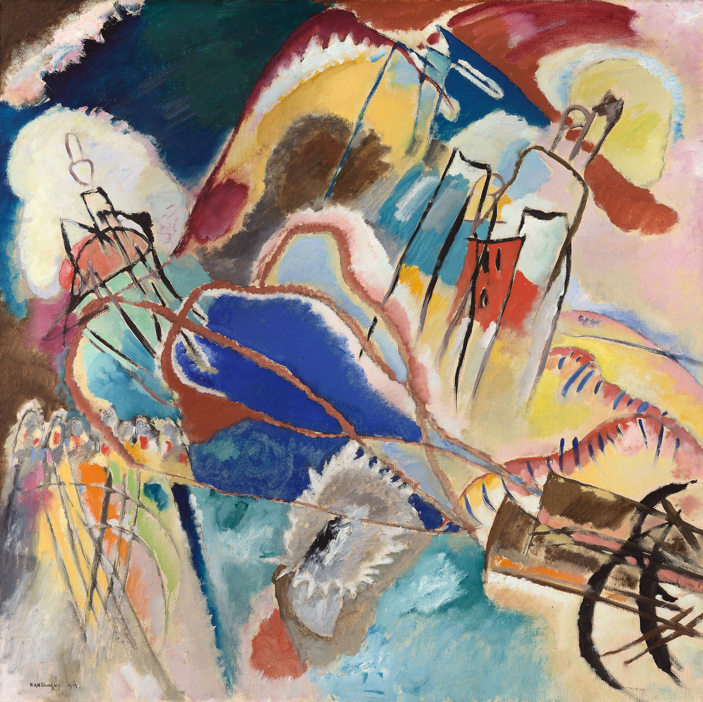

**Improvisation No. 30 (Cannons)**，1913。Oil on canvas。

- 馆藏：The Art Institute of Chicago，1931.511。
- 文件：3000 × 2997 px，3.65 MB；[本地原文件](originals/kandinsky-cannons-1913.jpg) · [馆方作品页](https://www.artic.edu/artworks/8991)。
- 拟用：**第一章｜当答案变得不稀奇**。曲线、色块和穿行的黑线提供比规则格网更有张力的视觉选择，适合第一章的问题展开。
- 权利依据：馆方官方 API 全量导出中该作品 is_public_domain=true、copyright_notice=null；Commons 对此数码复制件明确标示 CC0，上传记录列出馆方原始 IIIF 图像 URL。馆方开放图像政策允许商业与非商业再利用。
- 注意：标题与画面含大炮及冲突线索，不把它描述成纯装饰性的彩色抽象。 馆方实时端点本次不可用，保存可追溯馆方的 Commons 高清导出，非当前母版的字节相同副本。历史图像 ID 与馆方当前记录不同，均在 source-checks.json 留存。
- 核验来源：[来源 1](https://commons.wikimedia.org/wiki/File:Vasily_Kandinsky_-_Improvisation_No._30_(Cannons)_-_1931.511_-_Art_Institute_of_Chicago.jpg) · [来源 2](https://api.artic.edu/api/v1/artworks/8991) · [来源 3](https://github.com/art-institute-of-chicago/api-data) · [来源 4](https://artic-api-data.s3.amazonaws.com/artic-api-data.tar.bz2) · [来源 5](https://www.artic.edu/open-access/open-access-images)。

建议署名：Vasily Kandinsky, Improvisation No. 30 (Cannons), 1913. The Art Institute of Chicago, Arthur Jerome Eddy Memorial Collection, 1931.511. CC0; museum image via Wikimedia Commons.

### A20 · Piet Mondrian · 黄、黑、蓝、红与灰的菱形构成

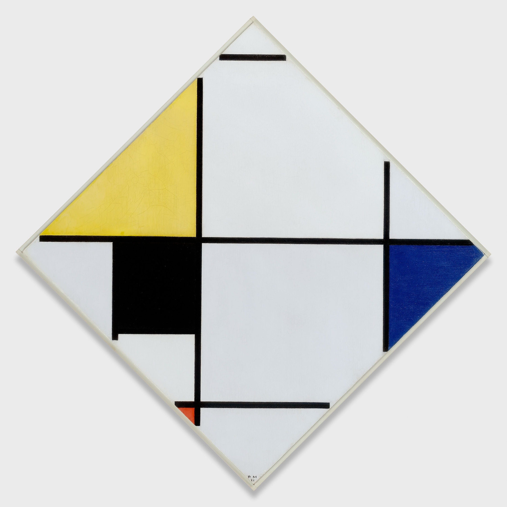

**Lozenge Composition with Yellow, Black, Blue, Red, and Gray**，1921。Oil on canvas。

- 馆藏：The Art Institute of Chicago，1957.307。
- 文件：3000 × 3000 px，0.69 MB；[本地原文件](originals/mondrian-lozenge-1921.jpg) · [馆方作品页](https://www.artic.edu/artworks/109819)。
- 拟用：**第四章｜生意开始以后的一天**。菱形外缘与内部横竖分割形成不对称平衡，可与第四章关于边界和留白的讨论并置。
- 权利依据：馆方官方 API 全量导出中该作品 is_public_domain=true、copyright_notice=null；Commons 对此数码复制件明确标示 CC0，上传记录列出馆方原始 IIIF 图像 URL。馆方开放图像政策允许商业与非商业再利用。
- 注意：图像包含菱形画布外的浅灰背景，不是裁成正方形的画心。 馆方实时端点本次不可用，保存可追溯馆方的 Commons 高清导出，非当前母版的字节相同副本。历史图像 ID 与馆方当前记录不同，均在 source-checks.json 留存。
- 核验来源：[来源 1](https://commons.wikimedia.org/wiki/File:Piet_Mondrian_-_Lozenge_Composition_with_Yellow,_Black,_Blue,_Red,_and_Gray_-_1957.307_-_Art_Institute_of_Chicago.jpg) · [来源 2](https://api.artic.edu/api/v1/artworks/109819) · [来源 3](https://github.com/art-institute-of-chicago/api-data) · [来源 4](https://artic-api-data.s3.amazonaws.com/artic-api-data.tar.bz2) · [来源 5](https://www.artic.edu/open-access/open-access-images)。

建议署名：Piet Mondrian, Lozenge Composition with Yellow, Black, Blue, Red, and Gray, 1921. The Art Institute of Chicago, Gift of Edgar Kaufmann, Jr., 1957.307. CC0; museum image via Wikimedia Commons.

### A21 · Vasily Kandinsky · 有三驾马车的画

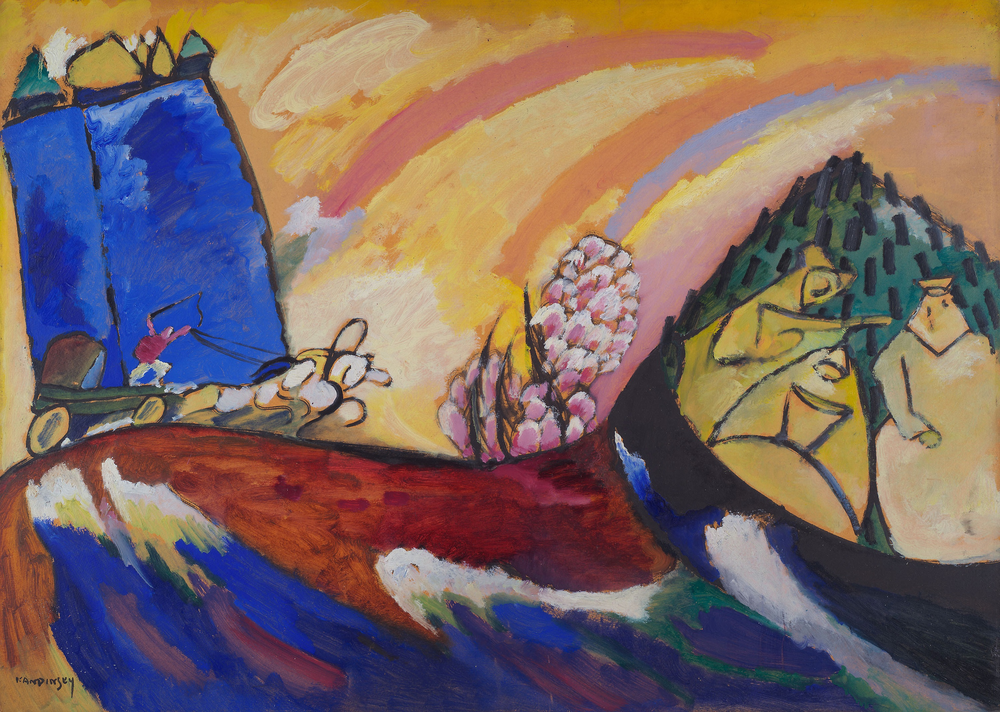

**Painting with Troika**，January 18, 1911。Oil on cardboard; in artist's painted frame。

- 馆藏：The Art Institute of Chicago，1931.509。
- 文件：3000 × 2136 px，2.21 MB；[本地原文件](originals/kandinsky-troika-1911.jpg) · [馆方作品页](https://www.artic.edu/artworks/8983)。
- 拟用：**第五章｜还要不要继续**。强烈色带和方向变化可以提供不同于纯几何图的尾声；保留看得见的道路与行进意象。
- 权利依据：馆方官方 API 全量导出中该作品 is_public_domain=true、copyright_notice=null；Commons 对此数码复制件明确标示 CC0，上传记录列出馆方原始 IIIF 图像 URL。馆方开放图像政策允许商业与非商业再利用。
- 注意：早期半抽象风景，仍可辨认马车、树木与山丘，不是纯非具象作品。馆藏媒介说明含艺术家所绘画框；此文件实际呈现绘画正面。 馆方实时端点本次不可用，保存可追溯馆方的 Commons 高清导出，非当前母版的字节相同副本。历史图像 ID 与馆方当前记录不同，均在 source-checks.json 留存。
- 核验来源：[来源 1](https://commons.wikimedia.org/wiki/File:Vasily_Kandinsky_-_Painting_with_Troika_-_1931.509_-_Art_Institute_of_Chicago.jpg) · [来源 2](https://api.artic.edu/api/v1/artworks/8983) · [来源 3](https://github.com/art-institute-of-chicago/api-data) · [来源 4](https://artic-api-data.s3.amazonaws.com/artic-api-data.tar.bz2) · [来源 5](https://www.artic.edu/open-access/open-access-images)。

建议署名：Vasily Kandinsky, Painting with Troika, January 18, 1911. The Art Institute of Chicago, Arthur Jerome Eddy Memorial Collection, 1931.509. CC0; museum image via Wikimedia Commons.

### A22 · Paul Klee · 走钢丝的人

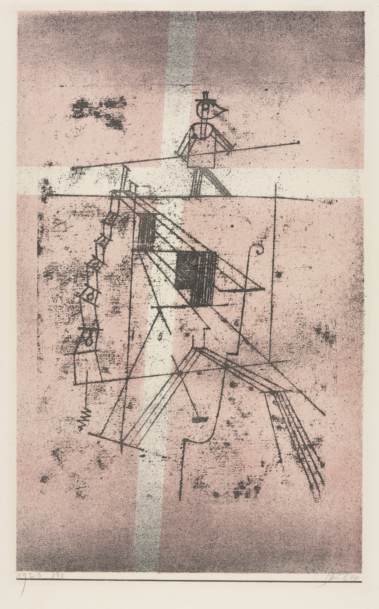

**Tightrope Walker**，1923。color lithograph。

- 馆藏：The Cleveland Museum of Art，1961.154。
- 文件：2120 × 3400 px，7.06 MB；[本地原文件](originals/klee-tightrope-walker-1923.jpg) · [馆方作品页](https://www.clevelandart.org/art/1961.154)。
- 拟用：**第四章｜生意开始以后的一天**。细线、路径和小小的行走者形成脆弱的平衡，可作为第四章日常节奏与工作边界的轻线条方案。
- 权利依据：逐件馆方 API share_license_status=CC0；文件 URL 来自该条目 images.print。作品页允许复制、修改和分发；CMA 条款明确 CC0 内容可免费作商业与非商业使用及再分发。
- 注意：彩色石版画，可辨识走钢丝人物与抽象化路径，不是纯非具象油画。完整印张短边2120像素，适合小于约18cm宽的300ppi图版；未裁切或放大。
- 核验来源：[来源 1](https://www.clevelandart.org/art/1961.154) · [来源 2](https://openaccess-api.clevelandart.org/api/artworks/1961.154) · [来源 3](https://www.clevelandart.org/terms-and-conditions) · [来源 4](https://www.clevelandart.org/open-access)。

建议署名：Paul Klee, Tightrope Walker, 1923. The Cleveland Museum of Art, Gift of The Print Club of Cleveland, 1961.154. CC0.

[馆方更大 TIFF](https://openaccess-cdn.clevelandart.org/1961.154/1961.154_full.tif)：3205 × 5139 px，馆方报告 49,445,344 bytes。未入库。

## 原建议中仍需授权/咨询的三件

**这里只存文字链接，不含图片、缩略图或远程嵌图。** 没有联系馆方、提交申请或发生费用。

### R01 · Sophie Taeuber-Arp · 平衡

**Équilibre**，1934。Kunstmuseum Basel。

- 拟用：第二章｜什么不会被模型吞掉。保留为第二章中经验、关系与平衡的原建议。
- 状态：馆方站点条款要求商业使用与出版先获书面许可。未取得针对这张图的公开再分发许可，因此不下载、不提交图像，也不嵌入远程图片。
- 核验入口：[来源 1](https://kunstmuseumbasel.ch/en/collection/classical-modernism) · [来源 2](https://kunstmuseumbasel.ch/en/site-notice)。

供后续核对的署名：Sophie Taeuber-Arp, Équilibre, 1934. Kunstmuseum Basel, Gift by Hans Arp. Photo: Max Ehrengruber. 最终署名以许可文件为准。

### R02 · Piet Mondrian · 画面第IV号：红、灰、蓝、黄与黑的菱形构成

**Tableau No. IV; Lozenge Composition with Red, Gray, Blue, Yellow, and Black**，c. 1924/1925。National Gallery of Art, Washington，1971.51.1。

- 拟用：第四章｜生意开始以后的一天。原建议保留；已有开放的 Cleveland 构成作品可作替代。
- 状态：作品页明确不提供下载，并要求联系馆方。没有下载按钮不等于作品本身必然仍受版权保护，但不能据此获得这张媒体文件的开放使用依据。仅留链接，待询问。
- 核验入口：[来源 1](https://www.nga.gov/artworks/52614-tableau-no-iv-lozenge-composition-red-gray-blue-yellow-and-black) · [来源 2](https://www.nga.gov/terms-and-notices)。

供后续核对的署名：Piet Mondrian, Tableau No. IV; Lozenge Composition with Red, Gray, Blue, Yellow, and Black, c. 1924/1925. National Gallery of Art, Washington, 1971.51.1. 最终署名以馆方回复为准。

### R03 · Robert Delaunay · 同时打开的窗：第一部分，第三主题

**Windows Open Simultaneously 1st Part, 3rd Motif**，1912。Peggy Guggenheim Collection, Venice (Solomon R. Guggenheim Foundation, New York)，76.2553 PG 36。

- 拟用：第五章｜还要不要继续。保留为第五章开放、并置视角的原建议；已有开放的《节奏第2号》可比较。
- 状态：馆方 Imaging Service 采用复制申请/报价流程，未发现这件图像的开放许可。本次不下载、不提交；如选定须先确认具体书籍、电子版和公开仓库再分发的许可范围。未联系馆方、未付费。
- 核验入口：[来源 1](https://www.guggenheim-venice.it/en/art/works/windows-open-simultaneously-1st-part-3rd-motif/) · [来源 2](https://www.guggenheim-venice.it/en/art/imaging-service/)。

供后续核对的署名：Robert Delaunay, Windows Open Simultaneously 1st Part, 3rd Motif, 1912. Peggy Guggenheim Collection, Venice (Solomon R. Guggenheim Foundation, New York), 76.2553 PG 36. 最终署名以许可文件为准。

## 本轮未选入的例子

- [Klee《Architecture》](https://www.artic.edu/artworks/17540)：馆方官方数据 is_public_domain=false，虽第三方条目声称公版，本轮不存图。
- [Mondrian《Composition (No. 1) Gray-Red》](https://www.artic.edu/artworks/65821)：馆方对象数据公版为 true，但找到的 Commons 镜像只列艺术家页，缺少历史图像 ID，且提示需补美国公版依据；本轮保守地只留此链接。
- [Klee《With the Dot》](https://www.clevelandart.org/art/1961.50)：版权开放，但馆方说明包含一战死亡场景，与本书当前配图方向不合；未加入本分支，改选《计算中的老人》。

## 使用边界与取舍

- 逐图开放许可支持本次公开仓库存储；不能把馆藏机构的一般开放政策扩展到它的全部图像。版权期、摄影文件权利、合同和各地第三方权利仍可能不同，馆方亦不为所有司法辖区作保证。正式出版前按出版地和最终用法复核。不得暗示馆方为本书背书。
- A01 的馆方 API 可经检索读取，但直接图像下载被站点 403 阻挡，因此采用 Commons 保留的馆方 CC0 导出。A07 的馆方小图不够高清，因此采用对应馆方图像编号的高清镜像；两者都如实记录了镜像来源。
- 曾核对 Paris Musées 的同名《Rythme n°2》草图 AMD 1324 及《Rythme n°3》AMVP 1685。其 `/styles/4k/` URL 本次实际只有约 600 px 高，不能因路径含 `4k` 就视为高清；这些低清文件没有入库。A07 是另一件大型油画 AMVP 2575。
- A06 以馆方馆藏条目 1920 为主，保留原作题记 1914 的区别；不要把复制品的馆藏年代改写成未经核实的原画年代。
- 本次未把所有可见网页图都下载，也没有用来源不明的放大图补足数量。

## 校验

在仓库根目录运行：

```sh
node content/book/materials/art-candidates/verify-assets.mjs
node --test src/lib/book-reading.test.mjs
npm run lint
npm run build
```

资源校验不联网、不安装依赖：检查文件与清单一一对应、唯一馆藏/文件、README 本地预览、JPEG 像素、字节数、SHA-256、授权字段、待授权项目没有二进制、无远程嵌图和 review-only 状态。入库前另以 Pillow 完整解码并逐组查看图像。

本轮验证：资源校验、5 项书籍阅读逻辑测试、lint、production build 均通过。Lint 仍有仓库既有 hooks/unused-disable 警告；构建按仓库配置跳过 TypeScript 检查，不将 build 表述为完整类型检查通过。网站代码未变化，因此没有新增页面交互测试。
